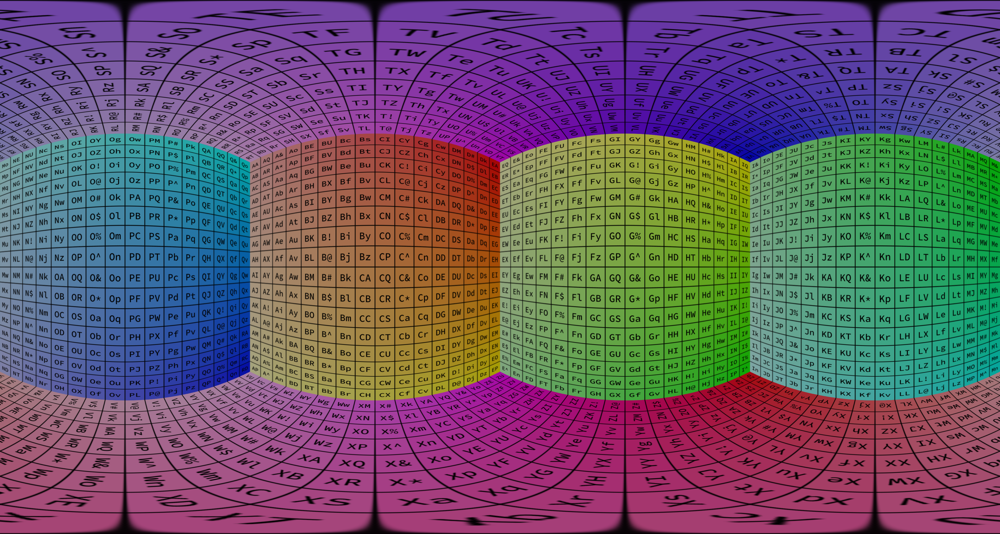

import Parameter from '/src/components/Parameter/Parameter';
import Link from '@docusaurus/Link';

# Equirectangular Projection
This projection method renders an equirectangular projection (also called lat-long projection or equidistant cylindrical projection) is a default projection method used for spherical objects or maps.

## Parameters

<Parameter name="type" type="string" defaultValue="EquirectangularProjection">
Defines the type of this projection.
</Parameter>

<Parameter name="quality" type={<Link to="/docs/config/basetypes#quality">Quality</Link>} optional>
Determines the pixel resolution of the cube map faces that are individually rendered to create the cylindrical rendering. The higher resolution these cube map faces have, the better quality the resulting cylindrical rendering, but this comes at the expense of increased rendering times. The named values are corresponding:

- `low`: 256
- `medium`: 512 (the default)
- `high`: 1024
- `1k`: 1024
- `1.5k`: 1536
- `2k`: 2048
- `4k`: 4096
- `8k`: 8192
- `16k`: 16384

Allowed values: `low`, `256`, `medium`, `512`, `high`, `1k`, `1024`, `1.5k`, `1536`, `2k`, `2048`, `4k`, `4096`, `8k`, `8192`, `16k`, `16384`, `32k`, `32768`, `64k`, `65536`
</Parameter>

## Examples

```json file=equirectangular.json
```


