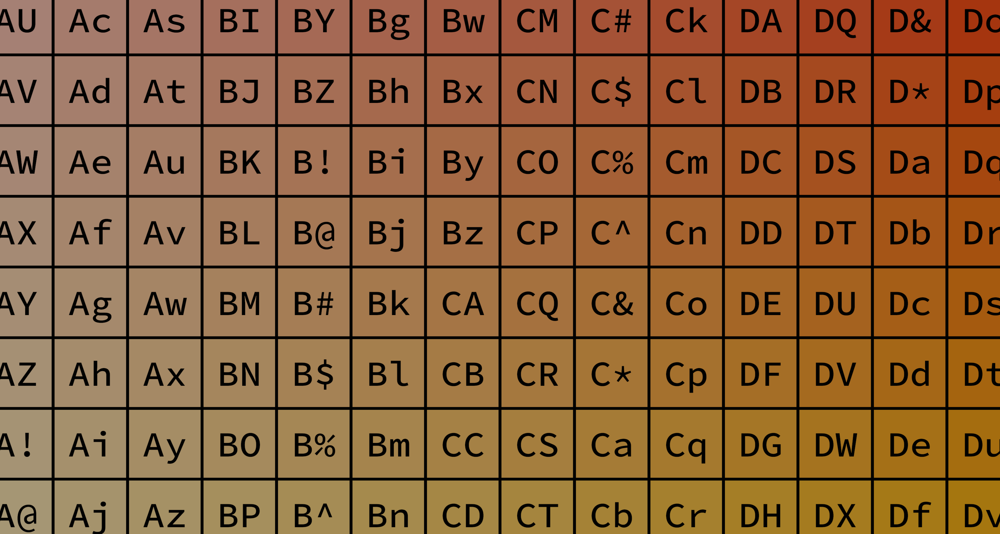
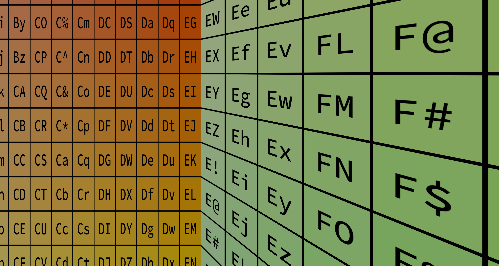
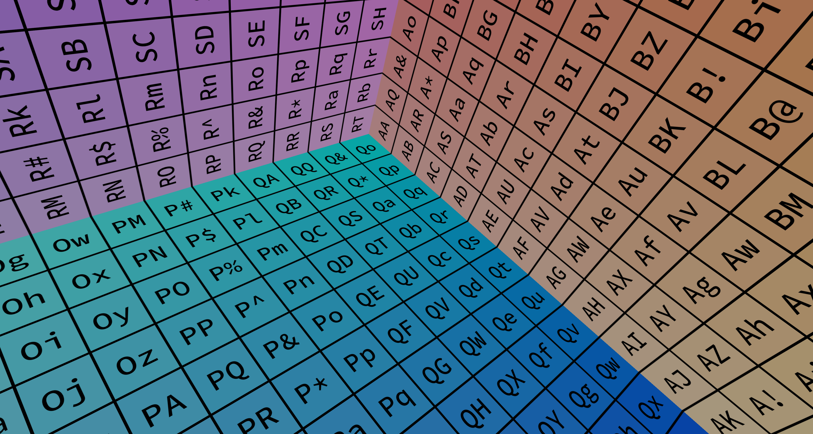

import Parameter from '/src/components/Parameter/Parameter';
import Link from '@docusaurus/Link';

# Planar Projection
Describes a projection for the Viewport that is a flat projection described by simple frustum, which may be asymmetric. If you are building a new configuration file and do not know which projection type you should use, this type is probably the right one.

## Parameters

<Parameter name="type" type="string" defaultValue="PlanarProjection">
Defines the type of this projection.
</Parameter>

<Parameter name="fov" type={<Link to="/docs/config/basetypes#fov">FOV</Link>}>
This element describes the field of view used the camera in this planar projection.
</Parameter>

<Parameter name="distance" type="number" optional>
The distance (in meters) at which the virtual render plane is placed. This value is only important when rendering this viewport using stereocopy as the `distance` and the User's `eyeseparation` are used to compute the change in frustum between the left and the right eyes.
</Parameter>

<Parameter name="orientation" type={<Link to="/docs/config/basetypes#orientation">Orientation</Link>} optional>
Describes a fixed orientation for the virtual image plane. This can be provided either as Euler angles or as a quaternion.
</Parameter>

<Parameter name="offset" type={<Link to="/docs/config/basetypes#vec3">vec3</Link>} optional>
A linear offset in meters that is added to the virtual image plane. Must define three float attributes `x`, `y`, and `z`. The default values are `x=0`, `y=0`, `z=0`, meaning that no offset is applied to the image plane.
</Parameter>

## Examples

### Symmetric
```json file=planar-symmetric.json
```



### Asymmetric
```json file=planar-asymmetric.json
```



### Orientation
```json file=planar-orientation.json
```


