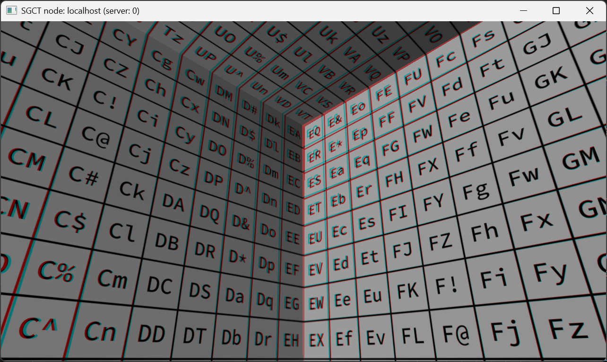

# Anaglyph Stereo
This example is rendering a stereo image of a flat projection using red-cyan anaglyph color mode. See [Stereo](../../config/window#stereo) for other stereo options.

```json file=anaglyph-stereo.json
```


