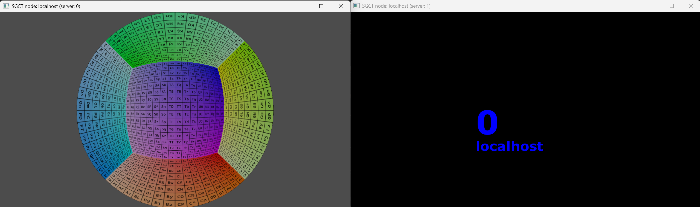

# Fisheye Presentation
This example creates two windows with different projection methods. The first window contains a fisheye rendering without any 2D UI graphics elements and the second contains only 2D elements. This type of setup is useful in cases where a presenter wants to show the rendered image to the audience, but does not want the user interface to show up.

```json file=fisheye-presentation.json
```


