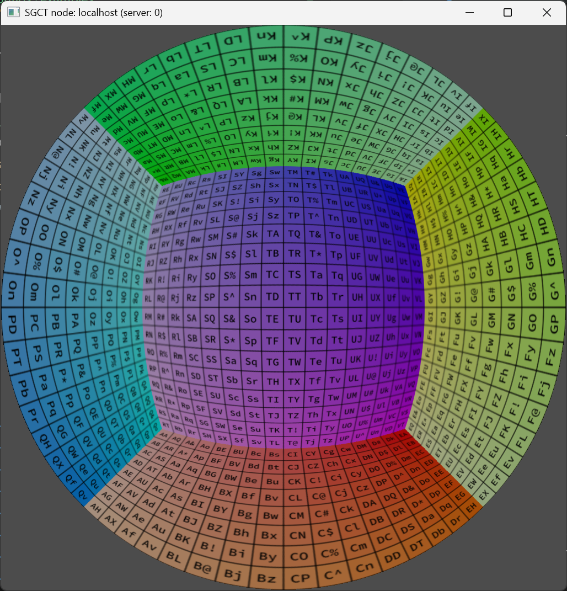

# Fisheye
This example is a fisheye rendering which demonstrates a more sophisticated rendering setup, which internally consists of many projections that are automatically assembled by SGCT into a single circular fisheye output.

```json file=fisheye.json
```


