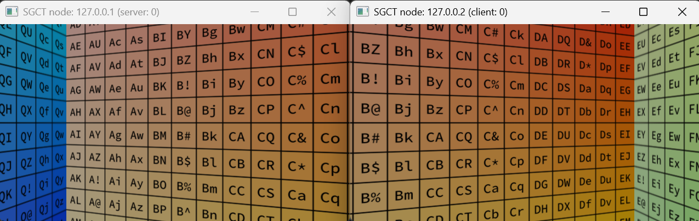

# Two Nodes
The following example is a configuration that creates two nodes, both running on the local machine, the difference being that their field-of-views are rotated by 40 degrees off the center. This type of setup is useful when driving two or more projectors from a single computer. Instead of calculating the field-of-view settings, it is also possible to use the [ProjectionPlane](../../config/projections/projectionplane) that takes coordinates to the screen coordinates, which are easier to measure in the real world.

```json file=two-nodes.json
```


