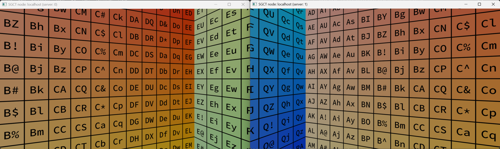

# Two Windows
This example is a variant on the Two Nodes example above. Instead of starting the application twice with one window each, this configuration file is using one instance that renders into two windows instead.

```json file=two-windows.json
```


