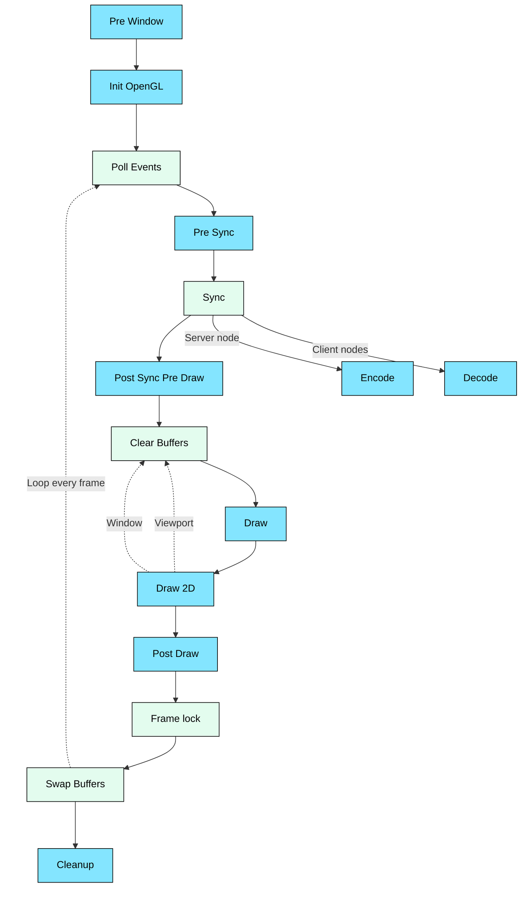

import stitchingImage from './stitching-illustration.webp';
import fisheyeCubemapImage from './fisheye-cubemap.webp';

# How it works

## Rendering
The central component in SGCT is a singleton class called the `Engine`. Its instance handles all initialization, rendering, network communication, and configuration handling. The application needs to bind callback functions to the engine to customize specific tasks, for example initialization, rendering, and input handling. To start SGCT's render loop, the function `Engine::instance().exec()` has to be called and it will only return once the application is ready to be terminated. The registered callbacks are called in different stages in the rendering process illustrated below:

Blue boxes represent callback functions that can be set by the application in the `Engine::Callbacks` struct that is passed to `Engine::create`. None of the callbacks are necessary for the operation of SGCT. Following is a description of the callbacks and what they can be used for in the generic case.

### Pre Window
This callback (`preWindow`) is called by SGCT once before the windows for the node are created and thus before any OpenGL context is created, which means that no OpenGL calls should be made in this callback. However, the configuration has already been read at this point and the network connecting the server and clients has been initialized.

### Init OpenGL
This callback (`initOpenGL`) is executed once after all windows for the node have been created and everything related to OpenGL in SGCT has been initialized. SGCT creates an OpenGL context for each window and an additional shared OpenGL context. The callback function receives a pointer to the shared OpenGL context (`GLFWwindow*`) which can be used by the application to either initialize OpenGL objects or create additional contexts.

This callback is usually used by applications to load textures, compile shaders, and do other initial setup before the render loop starts.

### Poll Events
In the beginning of the render loop, the input devices are polled from the operating system and the registered callbacks are executed. All of these callbacks are based on the GLFW input system, documentation of which can be found in the [GLFW input guide](https://www.glfw.org/docs/latest/input_guide.html). Apart from the `drop` callback, every input callback also receives a pointer to the `Window` in which the event occurred.

#### Mouse Button
This callback (`mouseButton`) is called whenever the state of a mouse button changes. The arguments to this function are the button that changed, any keyboard modifier that was pressed at the time (`Shift`, `Control`, `Alt`, or `Super`), and the action that caused the callback.

#### Mouse Position
This callback (`mousePos`) is called whenever the position of the mouse changes. The arguments to the callback are the x and y position in screen coordinates.

#### Mouse Scroll
This callback (`mouseScroll`) is executed when the position of the mouse's scroll wheel changes. The parameters to this function are the scroll offset along the x and y axes.

#### Keyboard
This callback (`keyboard`) is called whenever the state of a key on the keyboard changes. The parameters are the key that was changed, any modifiers on the keyboard (`Shift`, `Control`, `Alt`, or `Super`) that were pressed at the same time, the action that triggered the callback (Press, Release, or Repeat), and the system-specific scancode of the key.

#### Character
This callback (`character`) is called whenever a character was entered using the keyboard. The arguments to this callback are the Unicode code point of the character and the modifier keys that were pressed at the same time. The difference between this and the `Keyboard` callback is that the `Keyboard` responds to physical keys on the keyboard, whereas this callback is based on Unicode code points generated by the keys. In general, a physical key press can create any number of Unicode characters.

#### Drop
This callback (`drop`) is executed when the user drops one or more files onto one of the active windows of the application. The parameter is a list containing the paths of all files that were dropped.

### Pre Synchronization (PreSync)
This callback (`preSync`) is called before the synchronization stage during which data is synchronized from the server to the client nodes in the cluster. Values that are set in this callback by the server are serialized in the `encode` callback directly afterwards and are then available on the clients.

### Sync
This stage distributes the shared data from the server to the clients. The clients wait for the data to be received before the rendering takes place. Two callbacks have to be set for this stage to work; at runtime, SGCT determines which of the callbacks will be called. The data returned by the application in the `encode` callback is sent by the server to the clients via the network and its contents are then available in the `decode` callback. The `shareddata.h` file contains the two helper functions `serializeObject` and `deserializeObject` that can be used by the application to serialize its data. The [Shared data](/docs/overview/shared-data) page describes this mechanism in detail, including which types can be serialized this way.

#### Encode
This callback (`encode`) is only executed on the server, directly after the `preSync` callback, and the application is responsible to return a buffer containing the binary data that should be sent to the clients.

#### Decode
This callback (`decode`) will be called only on the clients at which time they can use the provided buffer to read the transferred data. It is called on the main thread once the server's data for the frame has been received and before the `postSyncPreDraw` callback.

### Post Synchronization Pre Draw (PostSyncPreDraw)
This callback (`postSyncPreDraw`) is called once the synchronized values are available and can be used to perform application-specific tasks. These might include, for example, synchronizing random number generator seeds, applying the physics computation performed on the server, reacting to user input, etc.

### Draw
This callback (`draw`) is executed by SGCT multiple times per frame and the application has to render its content in this step. The number of times this callback is executed depends on the configuration that was used to start the application. For example: for each monoscopic, flat viewport, the `draw` callback is called once, for each stereoscopic, flat viewport the `draw` callback is called twice, once for the left eye, once for the right eye. For a 180 degree fisheye, the `draw` callback is called four times, once for each cube map face that is used to construct the fisheye.

<figure>
  
  <figcaption>The four cube map faces that the `draw` callback renders for a 180 degree fisheye, and how they are arranged around the camera</figcaption>
</figure>

<figure>
  
  <figcaption>The final fisheye image that SGCT reprojects from these cube map faces</figcaption>
</figure>

In order to render correctly, the application **has** to use the `RenderData` struct that is passed as an argument to the callback. The struct contains:

  - `window`: The window that is currently being rendered
  - `viewport`: The viewport inside that window that is currently being rendered
  - `frustumMode`: Whether the current pass renders the left eye, the right eye, or a monoscopic image
  - `modelMatrix`: The transformation of the scene as specified by the [Scene](/docs/reference/configuration/scene) in the configuration file
  - `viewMatrix`: The view matrix of the current pass, which includes the orientation of the projection plane, the user's position, and the eye offset for stereoscopic rendering
  - `projectionMatrix`: The projection matrix of the current pass
  - `modelViewProjectionMatrix`: The product of the three matrices above
  - `bufferSize`: The size of the framebuffer that is rendered into, in pixels

An application that has its own camera combines its camera transformation with these matrices, for example `projectionMatrix * viewMatrix * modelMatrix * camera`, rather than computing its own projection, as only the matrices provided by SGCT produce a seamless image across viewports, windows, and nodes.

### Draw 2D
This callback (`draw2D`) is executed after all `draw` callbacks have been executed. This callback can be used by the application to render 2D elements, for example user interfaces. While there is no strict reason to split the `draw` and `draw2D` callbacks, the configuration files allow users to toggle the [`draw3d`](/docs/reference/configuration/window#draw3d) and [`draw2d`](/docs/reference/configuration/window#draw2d) settings for individual windows. This makes it easier to, for example, set up a scenario in which a user creates two windows, one window for controlling an application that omits the expensive 3D rendering, and a second window that only contains the 3D rendering but omits the user interface.

### Post Draw
This callback (`postDraw`) is called after the rendering is finished and before SGCT waits for frame lock or V-Sync, if these are enabled. The application can use this callback to trigger computations that can make use of excess CPU cycles that otherwise would be wasted while waiting for V-Sync, if the rendering is finished faster than the target frame rate.

### Frame lock
In the case of a clustered environment with more than one node that are **not** connected via NVIDIA's swap barriers, this stage of the render loop synchronizes the server and clients via lightweight network packages. With firm synchronization, each client notifies the server once it has finished rendering, and the server waits until the rendering on all nodes has finished before continuing. If there is only a single node or all nodes are in a swap group, this stage is effectively a null operation. The [Synchronization](/docs/overview/synchronization) page describes the different synchronization methods in more detail.

### Swap Buffers
At this point the front and back buffers (or both front and back buffers in the case of active stereo) are swapped. Either because of swap groups or because of the frame locking stage before, these swaps will happen on all machines simultaneously (*-ish* in the second case) to prevent tearing.

### Cleanup
This callback (`cleanup`) is called exactly once after the render loop of SGCT has been terminated by either closing all windows or calling the `Engine::terminate` function. The shared OpenGL context is still available in this callback and should be used by the application to clean up any remaining objects.
